<div align="center">

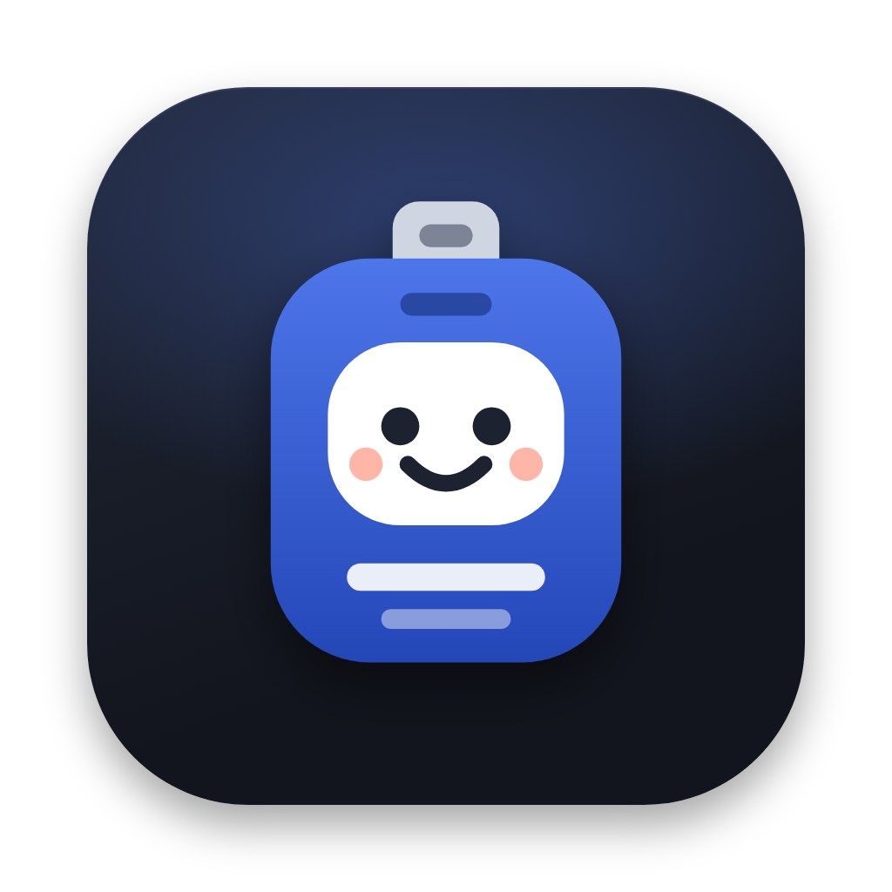

# OneCorp

**Run a company of AI employees, on your Mac.**

Hire a team on Claude Code or Codex, give them tickets, watch them work in your real repo, and approve what ships.

[](https://github.com/snowztech/onecorp/actions/workflows/ci.yml)
[](https://github.com/snowztech/onecorp/releases)
[](LICENSE)


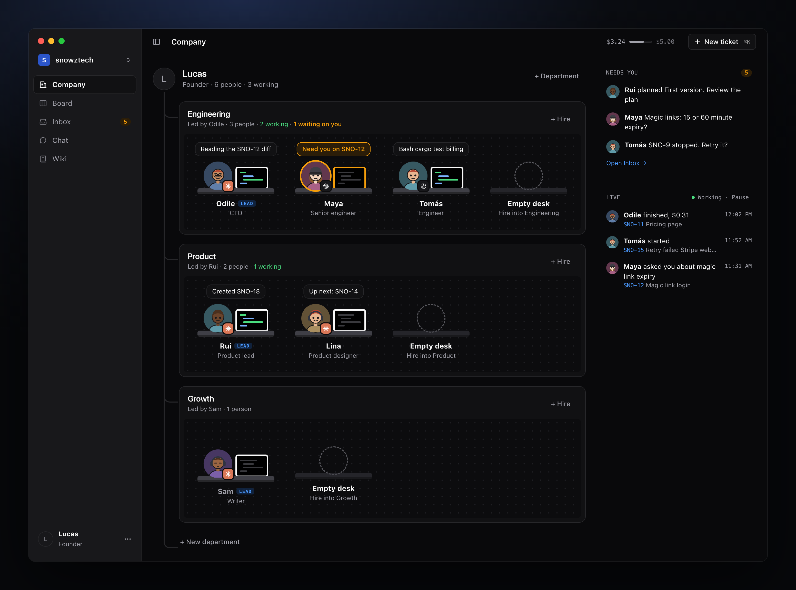

</div>

## Why

AI coding agents are good at a ticket. Running several of them on one product is where it gets messy: who's doing what, which branch, what did it cost, what needs a decision from you.

OneCorp gives that a shape you already know: a small company. Each agent is an employee with a name, a face, a role, a personality and a desk. They work in their own git worktree, ask their lead before they ask you, post in team chat, learn from your reviews, and hand you finished work as a pull request. You stay the founder: you decide what gets built and what ships.

Everything runs locally. There's no account and no server. Your agents use the Claude Code or Codex login you already have.

## What it looks like

**One inbox for everything that needs you.** Plans to approve, questions with a default answer, work to review, runs that stopped.

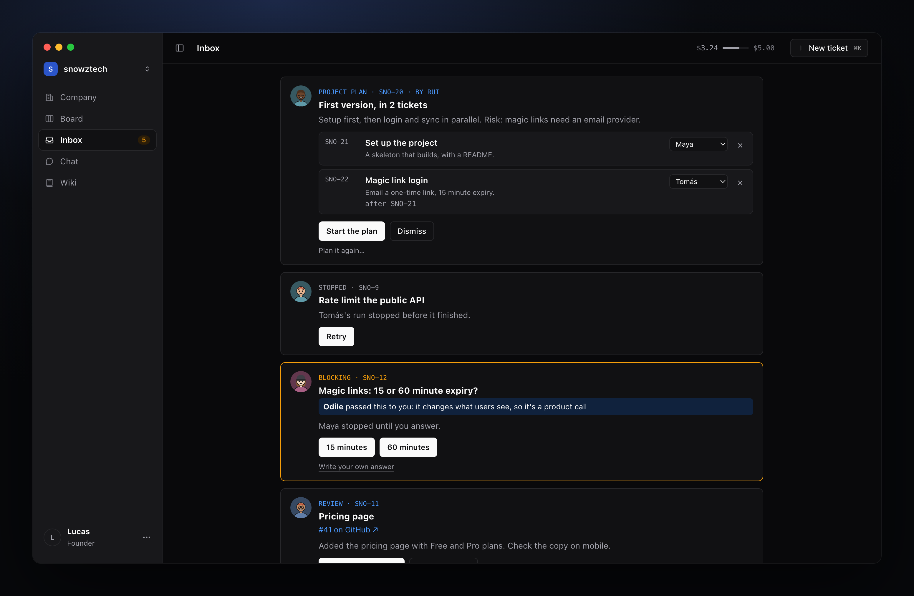

**Every run, step by step.** What they read, what they changed, the tests that failed and passed, the commit, and what it cost.

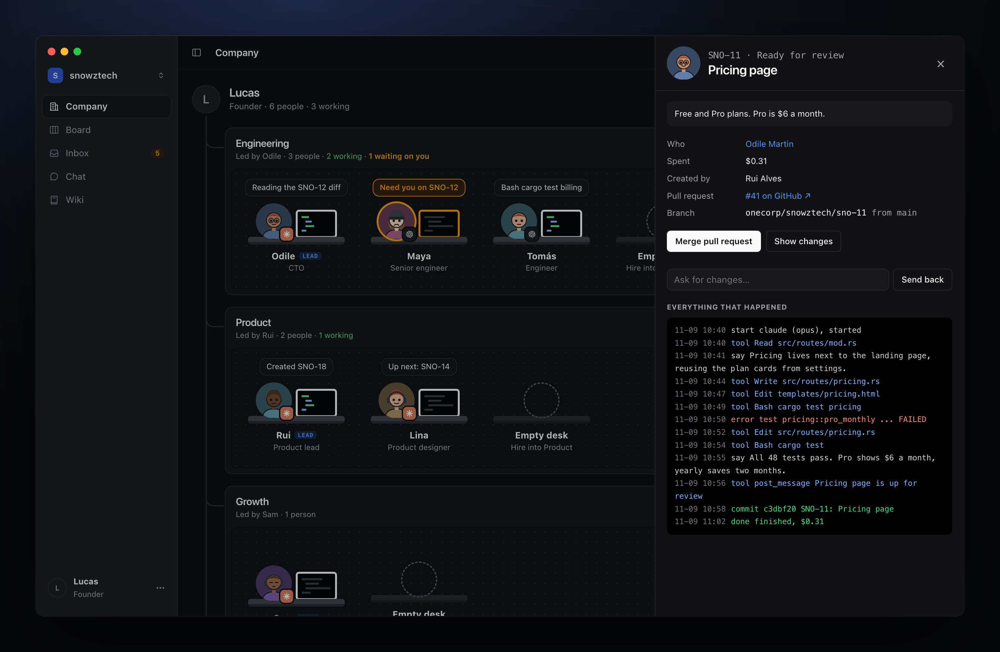

<table>
<tr>
<td width="50%"><b>A board for the work.</b> Projects with progress, tickets that wait for each other.<br><br>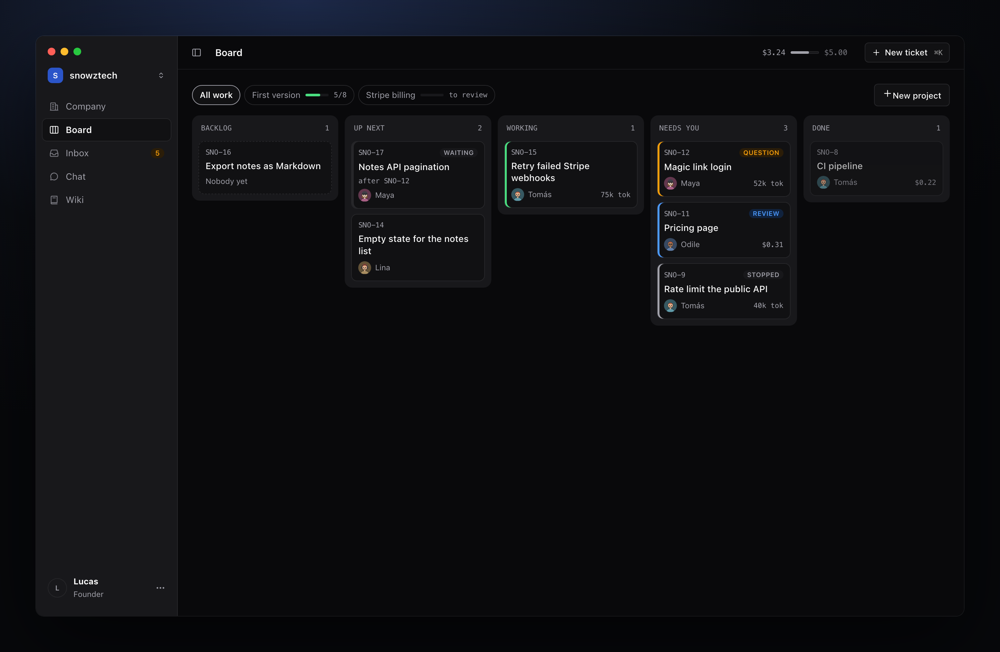</td>
<td width="50%"><b>Team chat.</b> Channels per department, direct messages, and @mentions that get a reply.<br><br>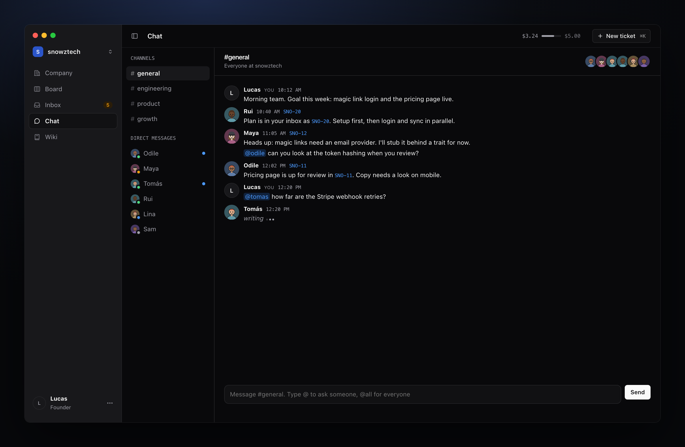</td>
</tr>
<tr>
<td width="50%"><b>Projects, planned for you.</b> Describe a feature, your planner breaks it into tickets with owners.<br><br>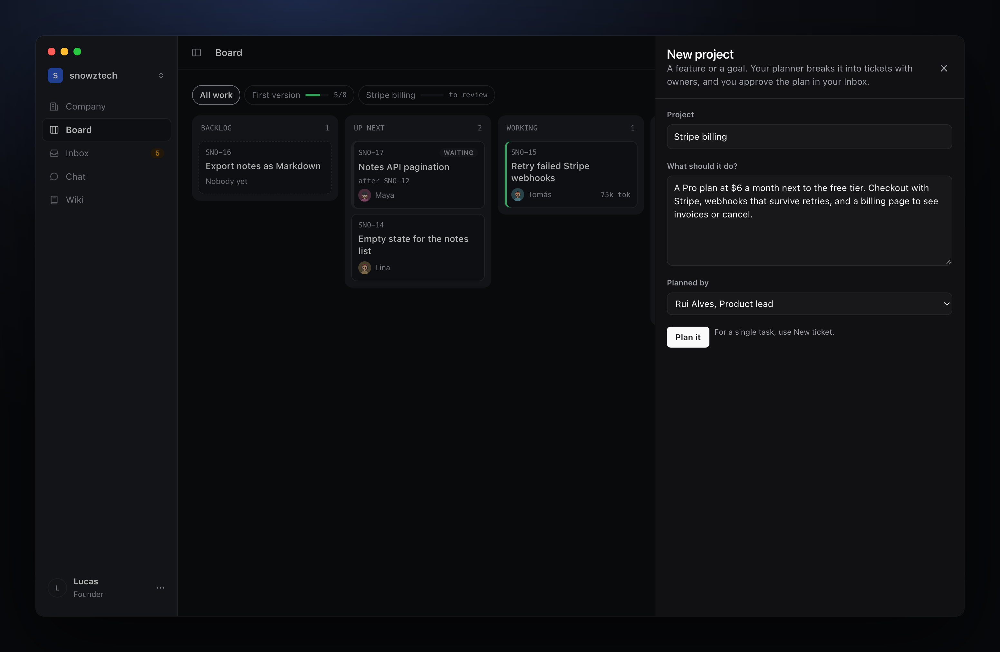</td>
<td width="50%"><b>A wiki everyone reads.</b> Decisions and conventions, proposed by the team, approved by you.<br><br>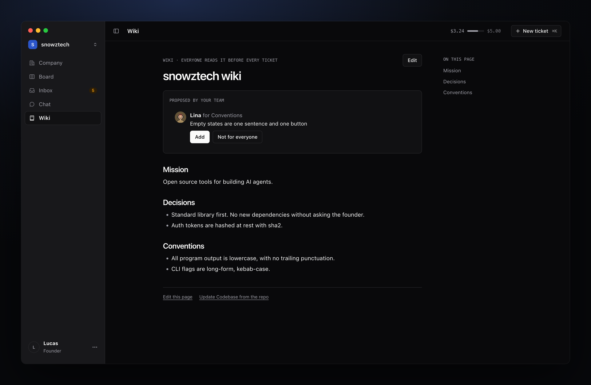</td>
</tr>
<tr>
<td width="50%"><b>Employees who learn.</b> Their personality, their current run, what they've learned and their tickets.<br><br>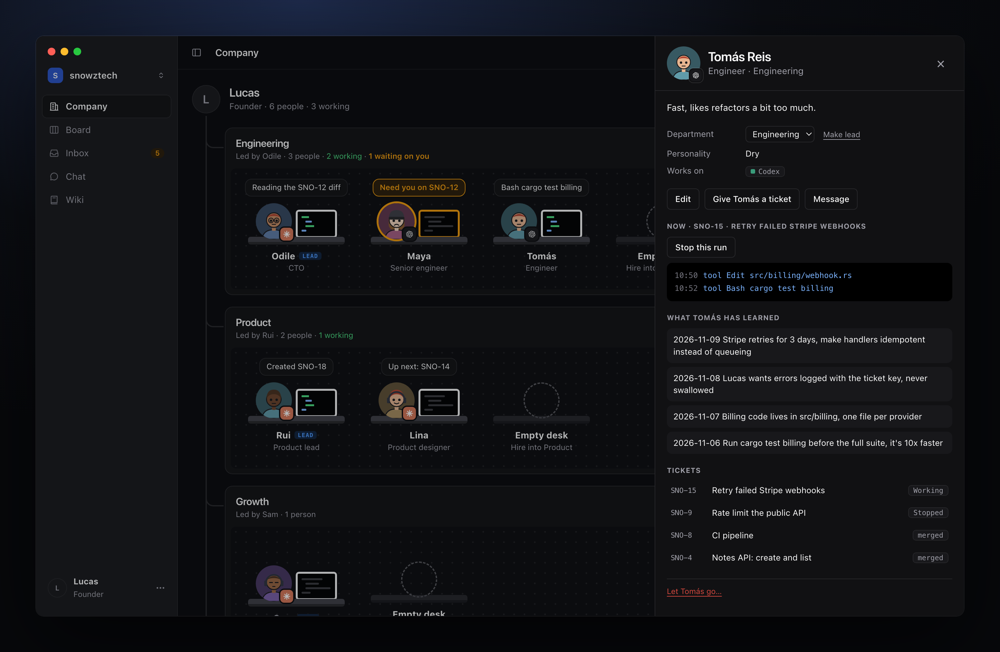</td>
<td width="50%"><b>Spending you can see.</b> Today against a daily budget, two weeks of history, and who spent what.<br><br>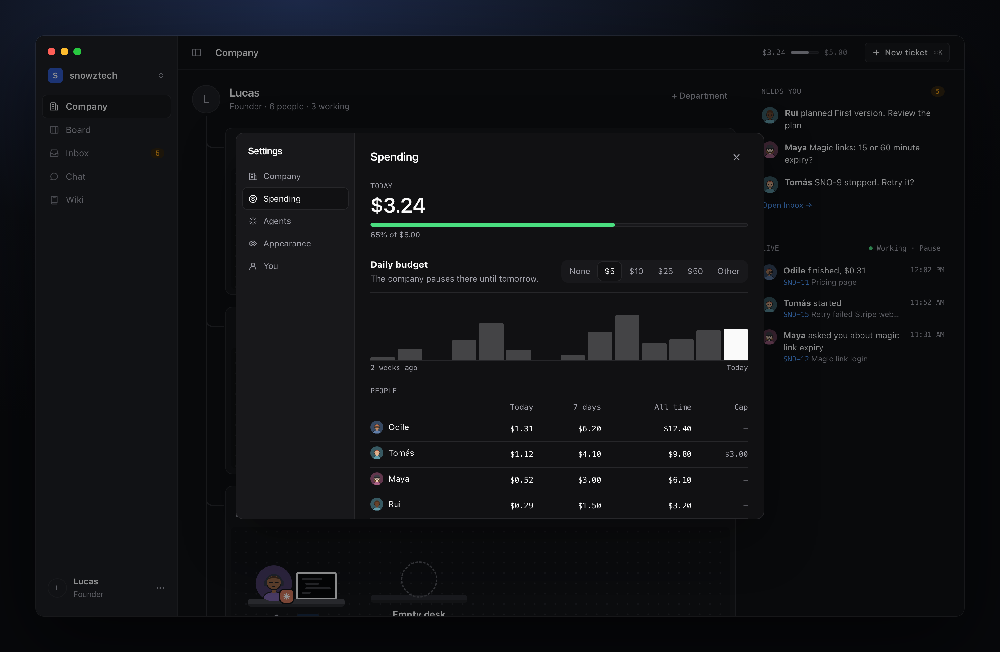</td>
</tr>
<tr>
<td width="50%"><b>A team in a minute.</b> Start from a template, each person with a role, an agent and a personality.<br><br>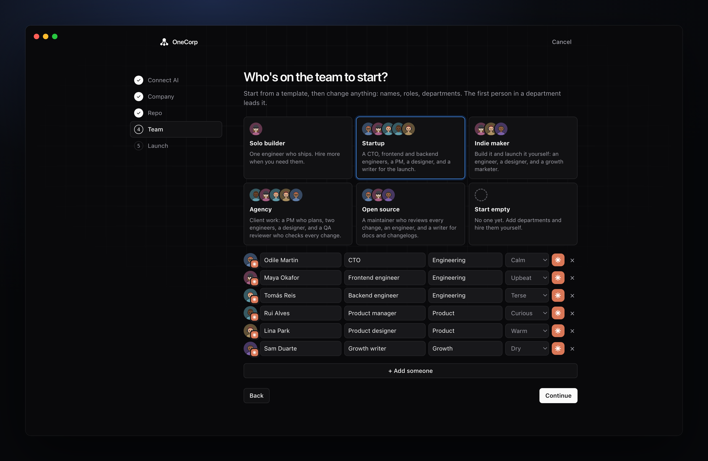</td>
<td width="50%"><b>Light or dark.</b> It follows your Mac, or pick one in Settings.<br><br>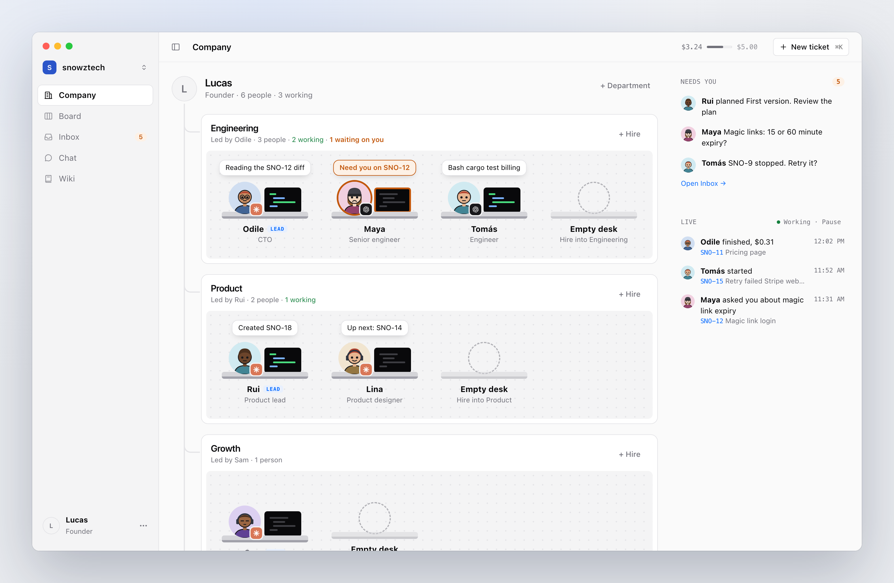</td>
</tr>
</table>

## Get started

1. Download `OneCorp.dmg` from [Releases](https://github.com/snowztech/onecorp/releases) and drag OneCorp to Applications.
2. Open it. The app isn't signed by Apple yet, so the first time, right-click OneCorp and choose **Open**, then **Open** again.
3. OneCorp walks you through the rest: you, your AI agents, your company, its repo (a folder on your Mac, one of your GitHub repos, or a new one) and a starting team.

Your employees need at least one of these, installed and signed in. OneCorp checks during setup and gives you the command for anything missing.

- [Claude Code](https://docs.anthropic.com/en/docs/claude-code): `npm install -g @anthropic-ai/claude-code`, then run `claude` once.
- [Codex](https://github.com/openai/codex): `npm install -g @openai/codex`, then run `codex` once.

For pull requests, install the [GitHub CLI](https://cli.github.com) and run `gh auth login`. GitLab works the same way with `glab`.

**What it costs:** your agents' usage, nothing else. OneCorp shows what every run spent, by person, project and agent. Set a daily budget and the company pauses when it's reached. On a Claude or ChatGPT plan, when the plan's usage limit is hit, the work waits and picks up again by itself at the reset.

## How it works

- **Tickets run in worktrees.** Each ticket gets its own branch and git worktree, so your checkout is never touched. When the agent finishes, OneCorp commits the work under the employee's name, like `Tomás Reis <tomas@snowztech.onecorp>`.
- **Agents run headless.** OneCorp starts `claude -p` or `codex exec` for each run, streams what they do, and resumes the same session when you answer a question or ask for changes.
- **They build and test.** OneCorp reads your repo (cargo, npm, pnpm, bun, yarn, go, pytest, make) and lets employees run those commands, so work comes back tested. Change the list in Settings.
- **Company tools over MCP.** Each run gets a small MCP server with the company's tools: ask the founder, post in chat, create a ticket, propose a wiki change, remember something. Your own MCP servers stay out.
- **Leads answer first.** Questions go to the department lead, who settles what the wiki and the code already decide and passes the rest to you with a reason.
- **A shared wiki and personal memory.** Every ticket starts with the company wiki and the employee's own notes, so a decision made once is known by everyone.
- **Shipping.** With a GitHub or GitLab remote, finished work opens a pull request and approving merges it. Otherwise approving merges on your Mac.

More in [docs/ARCHITECTURE.md](docs/ARCHITECTURE.md). Where it's going: [ROADMAP.md](ROADMAP.md).

## Command line

Everything the app does, the `onecorp` command does too. Both run on the same library, so they always agree.

```sh
onecorp doctor                                    # check git, the agents and your companies
onecorp new acme --repo ~/dev/acme --team startup # a company with a starting team
onecorp hire "Maya Okafor" --as engineer --personality warm
onecorp plan --brief "A notes app for writers"    # your team turns it into tickets
onecorp approve ACM-1                             # start the plan
onecorp run "add a --version flag" --to maya      # one ticket, right now
onecorp inbox                                     # what your team is waiting on
onecorp answer 1 "go with 15 minutes"
onecorp diff ACM-2                                # what a ticket changed
onecorp changes ACM-2 "use a match instead"       # send it back, same session
onecorp approve ACM-2                             # merge it, or merge its pull request
onecorp say "@all standup in 5"                   # team chat
onecorp serve                                     # run queued work, several people at a time
```

`onecorp help` lists every command. Set `ONECORP_HOME` to keep data somewhere other than `~/.onecorp`.

## Build from source

You need Rust, and Node 22 for the UI tests.

```sh
git clone https://github.com/snowztech/onecorp && cd onecorp
scripts/install.sh   # the onecorp command, and OneCorp.app in ~/Applications
make demo            # the app on a throwaway home, to try things safely
make check           # lint, tests, and a walk through onboarding in Chrome
```

```
crates/core/   the onecorp library: everything that runs a company
crates/cli/    the onecorp command, a thin shell over the library
app/           the desktop app: Tauri, with plain HTML, CSS and JS in app/ui
docs/          architecture, design rules, brand, screenshots
```

The UI also opens in a browser on sample data: open `app/ui/index.html`, and add a hash like `#inbox` or `#chat` to jump to a screen.

## Contributing

Issues and pull requests are welcome. Read [CONTRIBUTING.md](CONTRIBUTING.md) first: it's short.

## Credits

The optional Lorelei faces are by [Lisa Wischofsky](https://www.figma.com/community/file/1198749693280469639) and the Notionists faces by [Zoish](https://heyzoish.gumroad.com/l/notionists), both CC0, drawn with [DiceBear](https://www.dicebear.com) (MIT). The OpenAI mark comes from [Simple Icons](https://simpleicons.org) (CC0). Claude Code and Codex are products of Anthropic and OpenAI. OneCorp isn't affiliated with either.

## License

[MIT](LICENSE)
