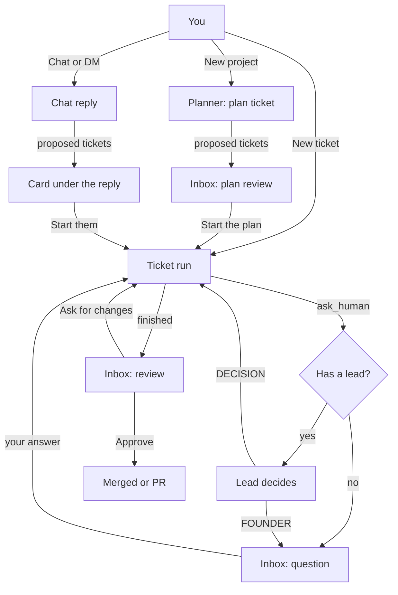

# How employees work together

This is every path work and talk can take between you and your team, and between employees. It's written against the code, so each part names where it lives. Use it to spot what's missing: the last section lists the gaps we know about.

[ARCHITECTURE.md](ARCHITECTURE.md) is the map of the code. This page is the map of the company.

## The shape of it

You're at the top. Departments have a lead. Everyone else reports to their department's lead. That's all the hierarchy there is (`store.rs`: `departments.lead`, `lead_of`).

There are two kinds of run:

- **A ticket run** does work. It gets its own git worktree, can change files, and has the company tools (`work.rs`: `run_ticket`, `drive`).
- **A talk run** answers something. It's read-only in the repo and is short: a chat reply, or a lead settling a question. A chat reply has no company tools. A lead deciding a question has them, but read-only (`chat.rs`: `reply`, `work.rs`: `consult`).

Nothing an employee does can start work on its own. Every ticket starts because you started it, approved a plan, or answered something that unblocks it. That's the line that keeps spending and shipping yours.

## Ways work starts

| You do | Who runs | What you get | Code |
| --- | --- | --- | --- |
| New ticket, given to someone | That person | A ticket run, then a review | `work::start` |
| New project | The planner | A plan of tickets with owners and an order, to approve | `work::plan_project`, `run_plan` |
| Ask someone in chat to look into or fix something | Them | Proposed tickets under their reply, one click to start | `chat::reply`, `chat::propose` |
| Write the wiki, or Redraft | Whoever drafts it | Wiki pages to save | `work::write_wiki` |
| Retry a stopped ticket | The same person | The same session picks up, or a clean start | `work::retry` |

**Who plans.** The planner is whoever you pick, or else the first person whose role sounds like product, or else a department lead (`work::pick_planner`). A plan is a ticket of kind `plan`. Its run is read-only and creates tickets with `create_ticket`. They wait in the backlog until you start the plan, which starts every one that has an owner (`start_proposed`).

**Chat proposals.** When you ask someone in chat to fix or build something, their reply can end with ticket lines, which become backlog tickets linked to that message. Anyone can propose tickets for themselves. A lead can also give them to anyone in the departments they lead. A ticket for someone outside that team goes to the person who proposed it. The card under the reply starts them, and opening one lets you change its owner or delete it.

**Order.** A ticket can wait for another (`after`). It starts by itself once that one is merged (`release_waiting`).

## Ways employees talk

### To you

- **`ask_human`**: a question with options and a default. Blocking stops the ticket until it's answered. Non-blocking carries on with the default, and a different answer later sends the ticket back to apply it (`work::follow_up`).
- **`ask_to_run`**: asks to run a command they aren't allowed yet. Always comes to you, never their lead: what runs on your Mac is your call. Allowing it lets the whole team run it in that repo.
- **`update_ticket` blocked**: always puts a question in your Inbox, so a blocked ticket always has something for you to answer (`store::ask_to_unblock`).
- **The summary** at the end of a ticket run is what you read in the review.

### Through their lead

When someone with a lead asks a question, it goes to the lead first (`mcp.rs`, stage `lead`). The lead gets a read-only talk run in the asker's worktree, with the wiki, and ends with one of:

- `DECISION: ...`: answered. The asker's ticket resumes with "Odile, your lead, answered".
- `FOUNDER: why`: passed up to you, with the lead's reason shown on the Inbox card.

Leads are told to pass up anything about product direction, money, anything public, security, or what the wiki says is yours. Anything unclear goes up, which is the safe side (`work::verdict`). Both outcomes are posted in the team's channel, so the team sees how questions get settled.

### To each other

- **`post_message`**: a short post in their team's channel, or another one, with `@mentions`. It's a record. Nobody is woken up by it.
- **Catching up**: before every ticket and every chat reply, an employee reads recent chat in their channels and what was said lately elsewhere (`chat::catch_up`, `seen_elsewhere`). So a post is read at the reader's next run, not live.
- **`create_ticket`** during a ticket run: proposes a follow-up, for themselves or a teammate. It's linked to the ticket it came from and waits for you (with a plan or report, starting it starts these).

### To the whole company

- **`propose_wiki`**: a rule or fact for everyone. You approve it in the Inbox, and then everyone reads it before every ticket.
- **`remember`**: a private note for themselves, read at the start of each of their tickets. Your review feedback also lands here (`request_changes`).

## What every run knows

Built fresh for each run (`work::company_knowledge`):

- The wiki, cut at 12,000 characters.
- Their playbook: what their role owns and how they work. Each role title has a default, like Backend engineer or CTO, and you can rewrite it for one person in their profile (`roles.rs`).
- How OneCorp works: tickets live in OneCorp, OneCorp does git, how to ask, how to write.
- Who works here: each person's team, whether they lead it, and what they're on right now.
- Their own notes, and recent chat.
- In chat, also their own tickets, their current steps and worktree, and any ticket named in the conversation, like TVC-4.

## How work comes back to you

- **Review**: approve to merge on your Mac or open a pull request. Ask for changes to resume the same session with your feedback. Discard to close the PR, delete the branch, and return the ticket to the backlog.
- **Reports**: a ticket that asks for advice comes back as a document, not a diff. Closing it can start the tickets it proposed.
- **Stopped**: a run that errored, was stopped or was interrupted. Retry, with a note if you want, or delete.
- **Usage limits**: work waits and picks back up by itself when the limit resets.

## Ask OneCorp

The help built into the app, under Help in Chat and in your profile menu. It isn't an employee: no desk, no tickets, no department, and nobody on your team reads what you say there. It runs on your first employee's agent with the chat model, read-only, only when you ask, and its spend counts toward your daily budget (`help.rs`).

It answers from OneCorp's docs, built into the app so they match your version (this page, ARCHITECTURE.md, the README and the changelog), and from your company as it is now: who does what, open tickets and why the stopped ones stopped. When something is a bug or an idea worth sharing, it drafts a GitHub issue. Review on GitHub opens the form filled in, and nothing is posted until you submit it.

Keeping these docs true is what keeps its answers true.

## Gaps we know about

Ways a real company works that OneCorp doesn't yet, roughly by how much they'd change things:

1. **Leads don't review.** Work from Maya goes straight to you. A real CTO looks first, sends back what's not ready, and passes up what is.
2. **Nobody hears a mention live.** `@maya` in a post is read at Maya's next run. There's no "Maya, can you check this?" that gets an answer while the asker waits.
3. **A ticket that waits doesn't hear about the one it waited for.** When TVC-6 starts after TVC-5 is merged, it gets the code but not TVC-5's summary or what the reviewer said.
4. **Leads can't move running work.** A lead can propose tickets but can't reassign, stop or reprioritize anything already started.
5. **Leads don't notice trouble.** A stopped ticket or a long block on their team reaches you, never them.
6. **Leads have nobody above them but you.** A lead's own question goes straight to you, even when another lead could settle it, like engineering asking product.
7. **The planner plans alone.** It assigns across departments, but no lead weighs in on their team's part before you see the plan.
8. **Chat replies can't do small things.** A reply can propose a ticket, but can't save a note, post in another channel or propose a wiki rule.
