# OneCorp guide

OneCorp runs a small company of AI employees on your Mac. You hire a team on Claude Code or Codex, give them work, and decide what ships. This guide walks through everything you can do, in the order you'll need it.

Nothing here needs an account or a server. Your employees use the Claude Code or Codex login you already have, and everything they do stays on your Mac and in your repo.

## Install and your first company

**Install OneCorp.**

```sh
brew install --cask snowztech/tap/onecorp
```

Or download [OneCorp.dmg](https://github.com/snowztech/onecorp/releases/latest/download/OneCorp.dmg) and drag it to Applications. It needs macOS 11 or later, on Apple silicon or Intel. After that it updates itself: a new version downloads in the background, and a restart applies it.

**Sign in to an agent.** Your employees run on Claude Code, Codex, or both. You need at least one.

| Agent | Install | Sign in |
|---|---|---|
| Claude Code | `npm install -g @anthropic-ai/claude-code` | `claude` |
| Codex | `npm install -g @openai/codex` | `codex` |

**Set up your company.** The first time you open OneCorp, it asks for your name, checks your agents, then sets up the company:

1. **A name**, like your product's.
2. **A repo**: a folder on your Mac, one of your GitHub repos, or a new one.
3. **A starting team**, from a template. You can change everyone later.
4. **What you're building**, in a few sentences. This is the brief. With a brief and a team, your team plans a first version right away and drafts the wiki from your repo.

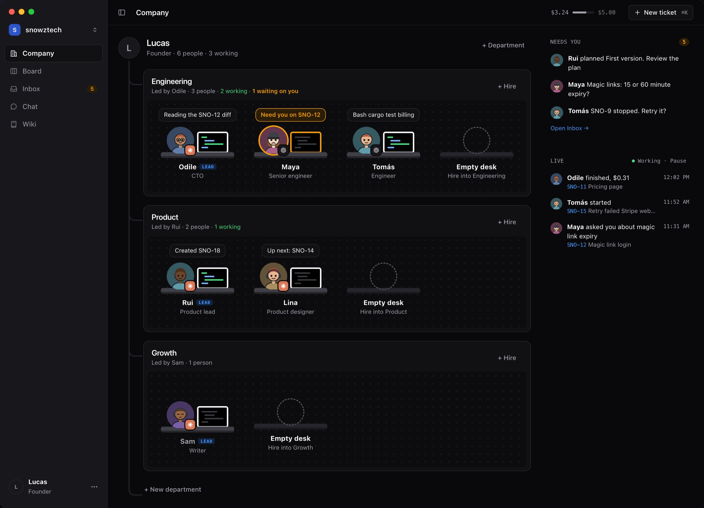

**Templates to start from:**

| Template | Who's in it |
|---|---|
| Solo builder | One engineer who ships |
| Startup | A CTO, frontend and backend engineers, a PM, a designer, and a writer |
| Open source | A maintainer who reviews every change, an engineer, and a docs writer |
| Indie maker | An engineer, a designer, and a growth marketer |
| Agency | A PM who plans, two engineers, a designer, and a QA reviewer who checks every change |
| Start empty | No one yet. Add departments and hire them yourself |

## Your team

Each employee has a name, a face, a role, a personality, an agent and a model. They sit at a desk on the Company page, grouped by department, and you can see what each one is doing.

**Hire someone** with the empty desk in a department, or `onecorp hire`. You choose:

- **Role**, like Backend engineer or Product designer. Their **playbook** comes from it: how someone in that role works. You can pick another playbook or rewrite it.
- **Agent and model**: Claude Code or Codex, and which model. Default is whatever you set in that agent yourself.
- **Effort on tickets**: Low, Medium, High, or the agent's default. Low takes fewer steps on routine work and costs less. The team shares its cached rules when everyone is on the same level, so pick one level for most of the team.
- **Personality**: terse, warm, thorough, dry, blunt, curious, upbeat or calm. It changes how they write, not how much.
- **Notes**: anything you want them to always know, like "we write Go with table tests". Your notes come after the playbook, so they win.

**Departments and leads.** Each department has a lead, the first person in it unless you pick another. Questions from the team go to their lead first, and the lead reviews their work before you see it. More in [Leads and reviews](#leads-and-reviews).

**What they learn.** Each employee keeps their own notes from past tickets, and your feedback when you ask for changes lands there too. Their profile shows what they've learned.

**Letting someone go** (`onecorp fire`) keeps their past tickets in the history. Tickets they hadn't started go back to the backlog with nobody on them, and OneCorp says which.

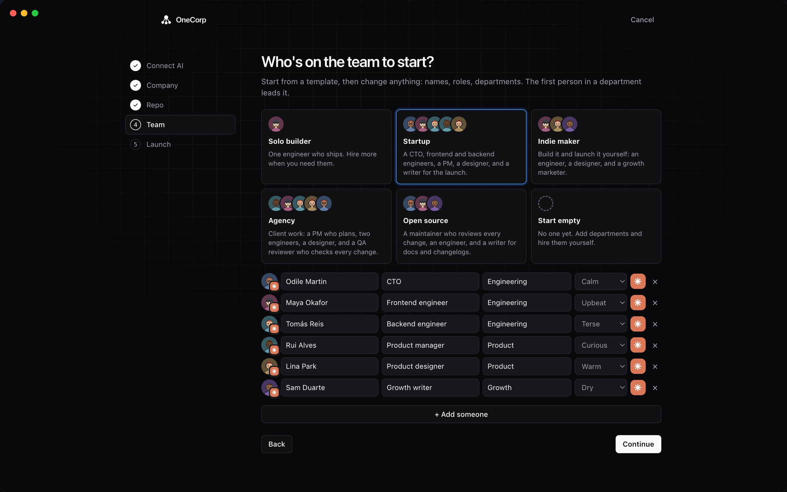

## Tickets and the Board

A ticket is one piece of work for one person. When it starts, OneCorp makes a branch and a git worktree for it, so your own checkout is never touched. The employee works there, runs your build and tests, and ends with a short summary. OneCorp commits the work under their name.

**Make a ticket** with New ticket (⌘K) or `onecorp run "add a --version flag" --to maya`. Say what done looks like in the details. A ticket can wait for another one: it starts by itself once that one is merged.

**The Board** shows every ticket by where it stands:

| Column | What's there |
|---|---|
| Backlog | Saved, not started |
| Up next | Waiting its turn, or waiting for another ticket to be merged |
| Working | Someone is on it now |
| Needs you | A question, work to review, or a run that stopped |
| Done | Merged or closed |

Click a ticket for everything that happened on it: what they read, the commands they ran, the tests that failed and passed, the commit, and what it cost.

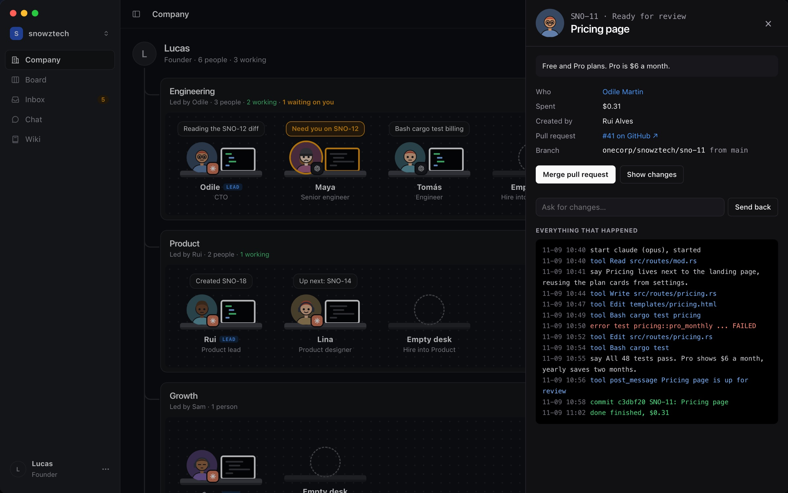

**Projects.** For something bigger than one ticket, use New project and describe the goal. A planner on your team, usually your PM, breaks it into tickets with owners and an order. The plan comes to your Inbox. Start it and every ticket starts, in order. Each ticket from a plan knows the project's goal and the other tickets in it, so the pieces fit.

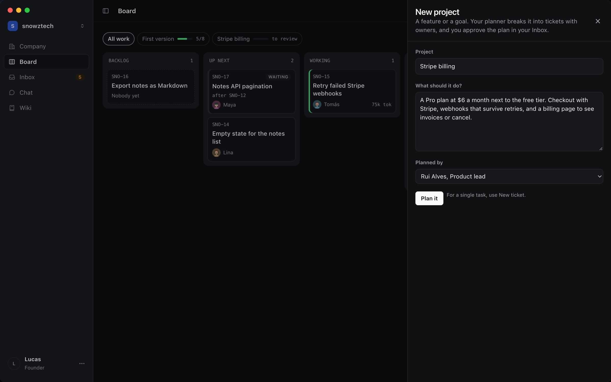

**Reports.** A ticket that asks for an audit, research or advice comes back as a document, not code. Closing it can start the follow-up tickets it proposes.

**Several repos.** A company can work across an app, its api and a site. Add them in Settings, Company. Each ticket happens in one repo, and a planner splits work that spans them.

## The Inbox

Everything that needs you lands in the Inbox, newest first.

- **Plans** to start, change or dismiss.
- **Questions.** Blocking ones stopped the ticket until you answer. Others came with a default the employee already went ahead with: answer differently and the ticket goes back to apply it. Tick "Save to the wiki" to make your answer a decision everyone reads.
- **Reviews**: finished work. Merge it, look at the changes, ask for changes in your own words (the same session picks it up), or discard it.
- **Stopped runs**, with why: retry, retry with a note, or delete.
- **Quiet runs**: someone who has shown nothing for a while. Keep waiting, or stop it. See [When something's off](#when-somethings-off).
- **Commands** an employee wants to run that aren't allowed yet.
- **Wiki proposals**: a rule a teammate thinks everyone should follow.

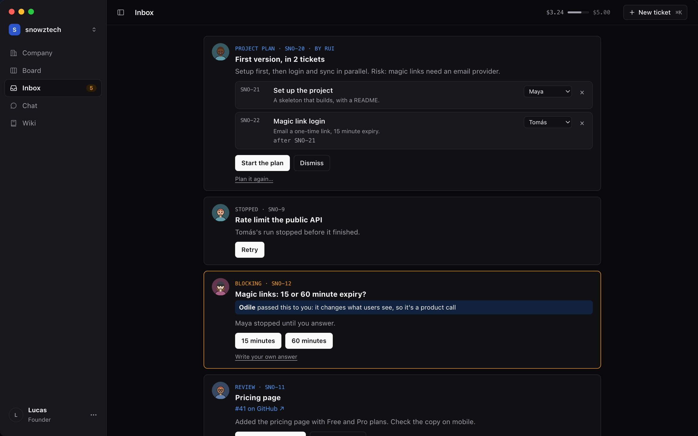

**Shipping.** With a GitHub or GitLab remote, finished work opens a pull request and merging it from the Inbox merges the pull request. You need the GitHub CLI (`gh auth login`) or `glab` for that. Without them, merging happens on your Mac. Change it in Settings, Company, Finished work.

## Leads and reviews

Leads are how your company handles most things without you.

**Questions go to the lead first.** When an employee with a lead asks something, their lead reads the code and the wiki and decides. Anything about product direction, money, anything public, security, or something the wiki says is yours, comes to you with the lead's reason. The team's channel shows how each question was settled.

**Leads review their team's work.** When someone with a lead finishes, the lead reads the changes in their worktree, runs the build and tests, and gives a verdict. Changes go straight back to the author. Work the lead is happy with reaches your Inbox with the verdict on the card. After two rounds of changes, it comes to you anyway with the lead's notes, to settle.

- Turn it off in Settings, Company, Reviews. Then work comes straight to you, and you can still ask a lead to review any of it from the Inbox, or with `onecorp ask-review`.
- An employee can ask a specific teammate to review their work instead.
- Merging is always yours.

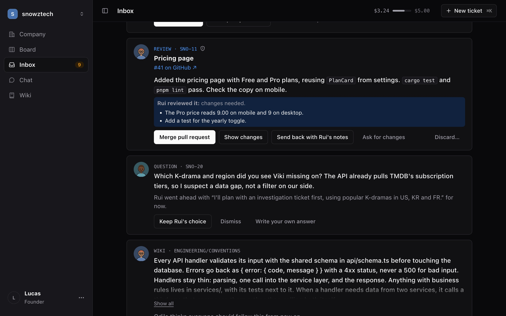

## Chat

Team chat has a channel for the whole company, one per department, and direct messages with each person.

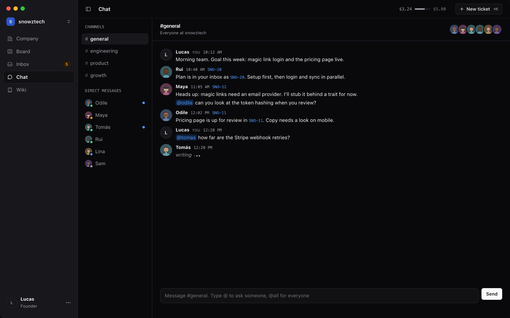

- **@mention someone** to ask them something. They read the code if it helps and reply in the channel. With no @mention, whoever replied to you last answers.
- **Ask for work in chat**, like "can you fix the login bug?", and their reply can propose tickets. Start them with one click under the reply.
- **They remember the conversation.** A reply sees the latest messages in full and a short summary of what you talked about before, so a long DM doesn't lose its start.
- **They know what the team finished.** Every reply knows the last 20 tickets the team merged, who did each and what changed, not only their own.
- **Employees ask each other.** While working, an employee can ask a teammate a question and gets the answer before going on. Both show in chat and on the ticket.
- **Replies appear as they're written.**
- Opening a channel never costs anything. Only a message that asks for a reply runs an agent.

**Ask OneCorp**, under Help in Chat, is the help built into the app. It answers how OneCorp works from this guide and your company as it is now, and drafts a GitHub issue when you found a bug. It isn't an employee, and nobody on your team reads what you ask it.

## The wiki

The wiki is what everyone on the team knows. Every ticket starts by reading it, so a decision made once is known by everyone.

- **Rules** pages are read in full before every ticket: the company overview, what's happening now, decisions, product rules and engineering conventions.
- **Reference** pages are listed, and read when the work needs them.
- Each department has its own space, read in full by the people in it.

Your team drafts the first version from your repo when the company starts. After that, employees propose changes and you approve them in the Inbox, or you edit pages yourself. Every page keeps its history. The Wiki page tells you when the rules get long, since long rules make every ticket cost more.

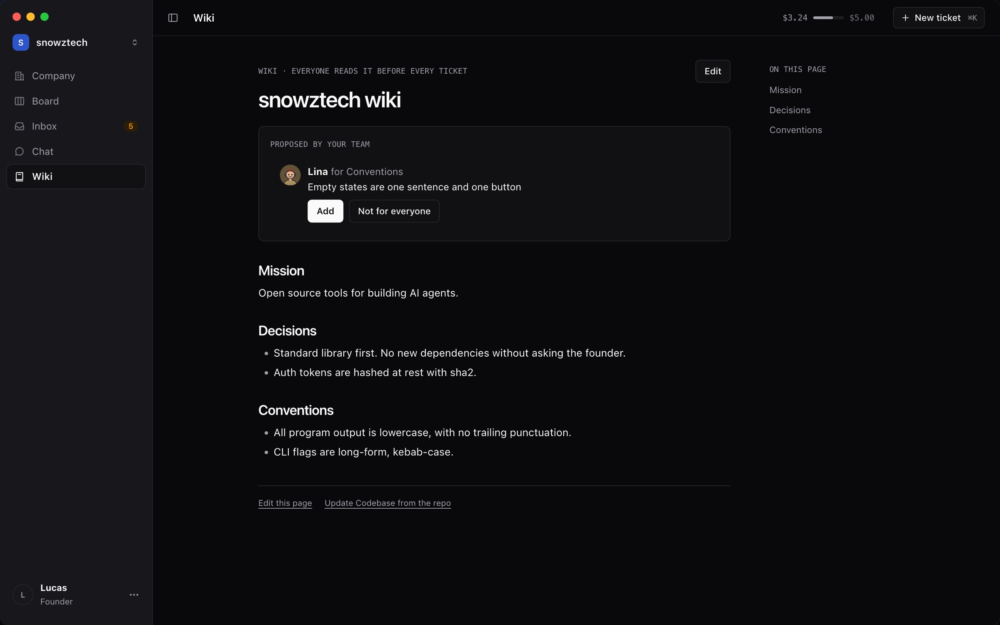

## Spending

OneCorp shows what every run cost, at API prices: what you'd pay on an API key, and what the same work would cost on a subscription. Codex reports tokens, not dollars, so its spend is an estimate, marked "est.".

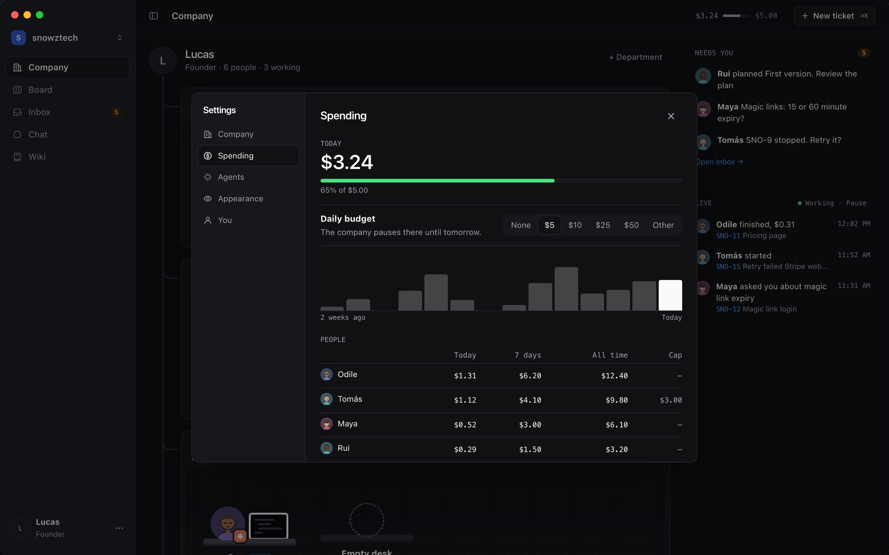

Settings, Spending is where you control it:

- **Show**: Dollars, or Plan usage on a Claude subscription. With Plan usage, the top bar shows how much of the 5-hour session and of the week is used, and hovering one says when it resets. People and tickets show the share of a session they used. That part is an estimate: Claude Code reports the plan in whole percents, and your own use of Claude counts too. Budgets stay in dollars.
- **Daily budget**: $10 to start. At 80% you get a heads-up. At 100% the company pauses until tomorrow, and a Claude Code run stops near the budget instead of going far past it. "Keep going today" lifts it until tomorrow.
- **Limit for one run**: $5 unless you change it. A ticket run that gets there stops with its work kept, and the Inbox asks whether to keep going.
- **A daily cap per person**, in their profile.
- **Chat and lead decisions** can run on a cheaper model than tickets: Cheapest, Balanced, or each person's own.
- **Plan limits.** On a Claude or ChatGPT plan, when the usage limit is hit, work waits and picks back up by itself when it resets. Spending says how often that happened this week.

Spending also breaks it down by person, project, kind of run and agent, over the last two weeks.

**What keeps it low:** one level of effort for most of the team, the cheaper model for chat, short wiki rules, and Low effort for routine tickets. Things OneCorp already does for you: rules and the wiki are cached once for the whole team, a chat reply sends only what changed, and a long command log isn't kept in the conversation.

## Repos and setup

**What employees can run.** By default, anything in their worktree, and their branch is theirs to commit and push. Changing git config or remotes, other branches, sudo, gh and deleting folders stay off. A pre-push guard keeps each worktree's pushes on its own branch. With "Only allowed" (Settings, Company, Commands), they run your repo's build and test commands only, and ask you for anything else in one request.

**Whose name is on the commits.** Settings, Company, Commits. As you: every commit is yours, from your git config, including the ones an employee makes during a run. As your team: the employee is the author and you're credited as co-author.

**Build and test commands.** OneCorp reads your repo and lists its build and test commands, for Rust, Node, Python, Go, Ruby, Java, .NET, Swift, Elixir, PHP, Flutter and more. Change the list per repo in Settings, Company.

**Env files.** A new worktree gets the env files from your checkout: `.env` and `.env.*` that git ignores, so employees start with the same keys and database URLs you have, and never commit them. When a ticket picks back up, it gets what you changed since.

To choose what's copied, add a `.worktreeinclude` file to your repo in .gitignore syntax. It's the same file `claude --worktree` reads.

```
.env*
config/local.yml
!.env.production
```

Folders git ignores, like `node_modules`, are never searched: a file in one is copied only when `.worktreeinclude` names it exactly.

**A setup command** runs in every new worktree before the employee starts, like `npm install` or a script of yours. Set it per repo in Settings, Company.

## Routines

Routines are work that comes back on a schedule: check dependencies every Monday, run the full test suite every night, go through new GitHub issues every morning.

Add one in Settings, Routines: what to do, who does it, and when. Every day, weekdays, one day a week at a time, or every few hours.

- Each time, it makes an ordinary ticket. You review it, and the budget and pause apply.
- It never piles up: while its last ticket is still open, it skips its turn and says so.
- A Mac that slept through a time runs it once when it wakes.
- Run now, Pause and Delete are next to each one.

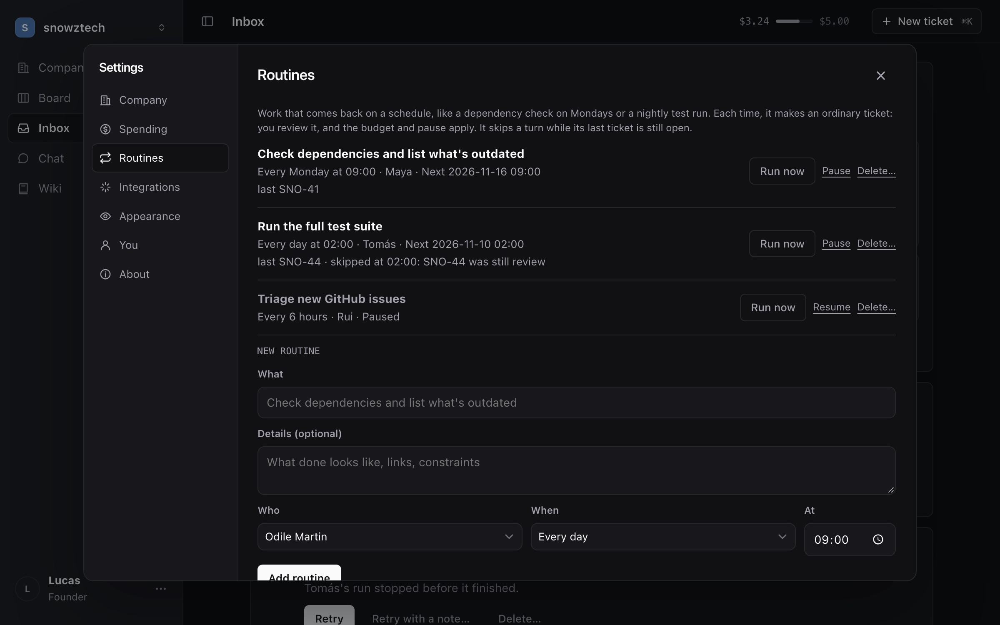

From the command line:

```sh
onecorp routine add "Check dependencies and list what's outdated" --to maya --every "monday 09:00"
onecorp routine            # list them, with when each runs next
onecorp routine run 1      # now
```

## Pause, quitting and updates

**Pause** (on the Company page, or `onecorp pause`) stops new work: running tickets finish, nothing new starts, and nobody replies in chat. Resume when you're ready.

**Closing the window** keeps the team working. OneCorp stays in the menu bar.

**Quitting or restarting to update** doesn't lose work. A ticket cut short picks up where it left off the next time OneCorp opens, in the same session. A paused company stays paused, so pause before quitting to keep the team from starting again.

**Backups.** OneCorp copies each company every hour while things change, and before an update changes anything, and keeps the copies for two weeks: tickets, chat, the Inbox, spend, the wiki and everyone's notes. Settings, Company shows the last one, makes one now, and puts one back after asking. What's there before a restore is copied too, so it can be undone.

## The command line

Everything the app does, the `onecorp` command does too. It installs from source for now: clone the repo and run `scripts/install.sh --cli`.

```sh
onecorp doctor                                    # check git, the agents and your companies
onecorp new acme --repo ~/dev/acme --team startup # a company with a starting team
onecorp hire "Maya Okafor" --as engineer --effort low
onecorp plan --brief "A notes app for writers"    # your team turns it into tickets
onecorp run "add a --version flag" --to maya      # one ticket, right now
onecorp inbox                                     # what your team is waiting on
onecorp answer 1 "go with 15 minutes"
onecorp diff ACM-2                                # what a ticket changed
onecorp changes ACM-2 "use a match instead"       # send it back, same session
onecorp approve ACM-2                             # merge it, or its pull request
onecorp ask-review ACM-2                          # have the author's lead review it first
onecorp say general "@all standup in 5"           # team chat
onecorp routine                                   # recurring work
onecorp backup                                    # copy the company now
onecorp serve                                     # run queued work, several people at a time
```

`onecorp help` lists every command, and `onecorp help <command>` explains one. Set `ONECORP_HOME` to keep data somewhere other than `~/.onecorp`.

## When something's off

**Start with `onecorp doctor`**, or Settings, Integrations. It checks git, each agent and its login, and your companies, and says how to fix what isn't right.

**A run is quiet.** When an employee shows nothing for 10 minutes, the Inbox says so, with their last step. Keep waiting, or stop it. After 30 minutes OneCorp stops it with the work kept, and Retry picks up where it was. Change the time, or turn it off, in Settings, Company, Quiet runs.

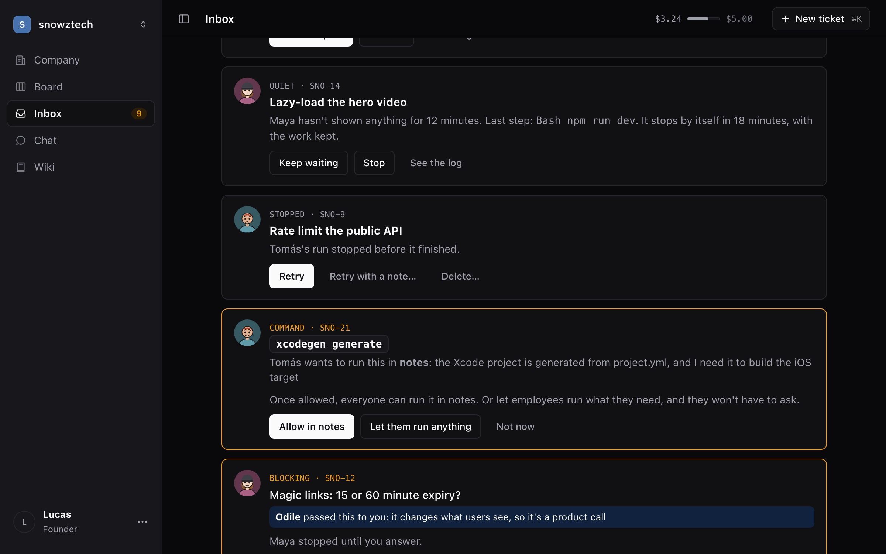

**A run stopped.** The Inbox card says why. Retry continues in the same session when it can. Retry with a note to tell them what to do differently.

**Work is waiting.** Check the banner at the top: the company may be paused, at its daily budget, or an agent may have hit its plan's usage limit. Work picks up by itself when a limit resets.

**An employee is missing a key or a database.** Their worktree gets your env files. If a file isn't copied, list it in `.worktreeinclude`. If they need a command that isn't allowed, they'll ask in the Inbox.

**Something looks like a bug.** Ask OneCorp in Chat. It drafts the GitHub issue for you, and nothing is posted until you submit it. Or open one at [github.com/snowztech/onecorp/issues](https://github.com/snowztech/onecorp/issues/new).
